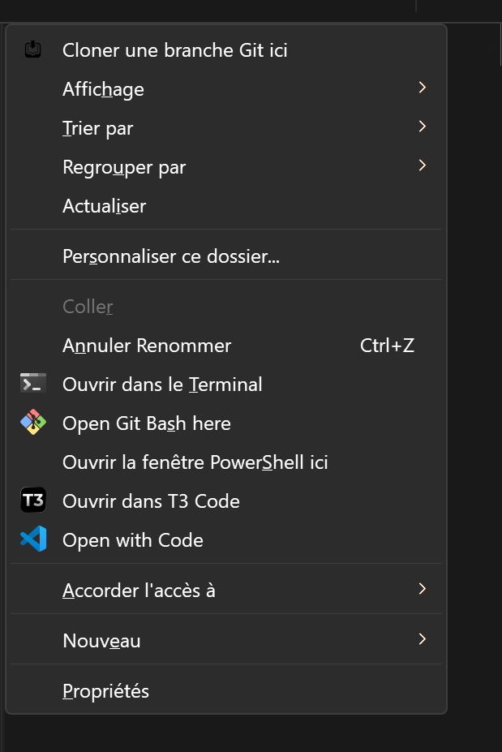

# T3 Code Enhanced (Windows)

Instant Windows Explorer right-click integration and startup optimizations for **T3 Code** (`pingdotgg/t3code`).

<p>
  
</p>

## Benchmarks

| Action | Before | After | Speedup |
| --- | --- | --- | --- |
| **Warm start** (app open → right-click) | 12.53 s | **0.07 s** | **~170×** |
| **Cold start** (app closed → folder open) | 36–42 s | **4.72 s** | **~8×** |
| Closed-app detection | ~21,000 ms | **15 ms** | **~1,400×** |
| Rotated trace logs | 131.9 MB | **~10 MB** | **-92%** |

## Quick Start

```powershell
# 1. Install right-click menu ("Ouvrir dans T3 Code") — no admin required
powershell -NoProfile -ExecutionPolicy Bypass -File .\install.ps1

# 2. Apply safe startup & log optimizations (add -All -EnableAutostart for ~70 ms opens all day)
powershell -NoProfile -ExecutionPolicy Bypass -File .\optimize-t3code.ps1

# 3. Optional: add Windows Defender exclusions (prompts for UAC)
powershell -NoProfile -ExecutionPolicy Bypass -File .\add-defender-exclusions.ps1
```

## Providers

[`docs/PROVIDERS.md`](docs/PROVIDERS.md) covers moving OpenCode to v2, what a provider switch (handoff) really passes to the next model, and adding **Oh My Pi** through the [omp-t3](https://github.com/hashangit/omp-t3) shim:

```powershell
# Pass 4x more history when switching provider mid-thread, teach every agent to re-read
# what was left out, and install the /recap command
powershell -NoProfile -ExecutionPolicy Bypass -File .\improve-handoff.ps1

# Add Oh My Pi as a T3 Code provider
powershell -NoProfile -ExecutionPolicy Bypass -File .\setup-oh-my-pi.ps1 -Favorites "<provider>/<model>"
```

### `/recap` before switching provider

When a thread switches provider, T3 Code hands the next model only an excerpt of the thread, and it tries to keep the **last answer** first. `/recap` makes that last answer a compact hand-off note, so it usually reaches the next model intact. It is not a guarantee: if the target model has almost no free context, T3 Code can drop it too (the next model is then told to re-read the thread).

1. Type `/recap` in the current conversation (optionally `/recap <point to focus on>`).
2. The model replies with a recap of at most 25 lines and no logs: goal, decisions, what's done (files, commits, tests), next steps, open questions, where to find details. It makes no tool calls.
3. Switch provider and carry on.

| Agent | How `/recap` works | Tested |
| --- | --- | --- |
| Claude Code | Command `~/.claude/commands/recap.md` (shows in the `/` menu) | ✅ |
| Oh My Pi (omp) | Same file: omp loads Claude Code's user commands | ✅ |
| OpenCode v2 | Command `~/.config/opencode/commands/recap.md` | ✅ |
| Codex | Global rule in `~/.codex/AGENTS.md` recognises `/recap` | ✅ |
| Antigravity / Gemini | Global rule in `~/.gemini/GEMINI.md` (T3 Code copies it into its Antigravity profile) | ✅ |

Use it on long threads. On short ones it is not needed. When switching back to a provider that already took part, it keeps its own memory but only gets what happened since its last turn, so `/recap` still helps if important decisions were made meanwhile. `/compact` is **not** a substitute: a compaction summary is not among the items T3 Code passes on a handoff.

`improve-handoff.ps1` never overwrites a `recap.md` it did not create. It records what it changed in `%LOCALAPPDATA%\t3code-enhanced\improve-handoff.json`, so `-Undo` puts back the previous value of the variable (or removes it if there was none), removes only its own blocks and files, and leaves alone anything you changed since.

## How It Works

`install.ps1` compiles [`open-in-t3code.cs`](open-in-t3code.cs) into a tiny (~8 KB) console-free WinExe using Windows' built-in `.NET 4` compiler (`csc.exe`). Instead of spawning Electron with `ELECTRON_RUN_AS_NODE=1` on every click, it talks directly to T3 Code's control named pipe (`\\.\pipe\t3code-app-<hash>`).

## Limitations

- On Windows 11, the entry appears under *Show more options* (`Shift + Right-click`).
- Uses T3 Code's desktop control named-pipe protocol v1 (`\\.\pipe\t3code-app-<sha256_24>`). The backend readiness port is read dynamically from `userdata\server-runtime.json` (ignored when its pid is dead), then `T3CODE_PORT`, then `3773`. If a future T3 Code release changes this internal protocol, `open-in-t3code.cs` may need an update (you can switch to `install.ps1 -UseVbs` in the meantime; re-run `install.ps1` if `T3CODE_HOME` changes in VBS mode).
- Relaunching immediately after closing T3 Code waits a few seconds for Electron's `SingleInstanceLock` to release during shutdown.
- The launcher always waits up to 20 s for T3 Code's answer (T3 Code itself gives up after 15 s). Closing the pipe earlier would cancel a request the app may already be processing, and retrying it could add the project twice. If T3 Code refuses or times out the request (`platform-mismatch`, `project-create-failed`, `request-timeout`, …), its own message is shown immediately instead of retrying.
- `optimize-t3code.ps1` disables `enableProviderUpdateChecks` (reversible in T3 Code settings; it only hides "provider update available" notices, so update Codex/Claude CLIs yourself) and only removes rotated trace archives (`*.ndjson.1`..`.10`); it never modifies T3 Code binaries or user data. T3 Code regenerates trace archives quickly (up to ~10 MB each), so the disk saving is temporary.
- `-EnableAutostart` launches the full T3 Code window at every Windows sign-in (T3 Code has no start-minimized mode).
- `add-defender-exclusions.ps1` excludes only the T3 Code install folder, `userdata\logs` and `statev2.sqlite*`. Attachments, provider downloads and worktrees stay scanned because they hold files fetched by agents. `-Broad` restores the old whole-`.t3` exclusion; `remove-defender-exclusions.ps1` removes both.

## Uninstall

```powershell
powershell -NoProfile -ExecutionPolicy Bypass -File .\uninstall.ps1
powershell -NoProfile -ExecutionPolicy Bypass -File .\remove-defender-exclusions.ps1
```

## Files

- [`open-in-t3code.cs`](open-in-t3code.cs) — Native C# launcher (direct named-pipe IPC)
- [`open-in-t3code.vbs`](open-in-t3code.vbs) — Fallback VBScript launcher
- [`install.ps1`](install.ps1) / [`uninstall.ps1`](uninstall.ps1) — Context menu installer & uninstaller (`HKCU`)
- [`optimize-t3code.ps1`](optimize-t3code.ps1) — Disables provider update checks, cleans rotated logs, optimizes SQLite, optional autostart
- [`add-defender-exclusions.ps1`](add-defender-exclusions.ps1) / [`remove-defender-exclusions.ps1`](remove-defender-exclusions.ps1) — Windows Defender exclusions
- [`setup-oh-my-pi.ps1`](setup-oh-my-pi.ps1) — Oh My Pi provider via omp-t3 (Bun/omp checks, GitHub-issue opt-in patch, `settings.json` + favorites)
- [`improve-handoff.ps1`](improve-handoff.ps1) — Max handoff excerpt (`T3CODE_CONTEXT_HANDOFF_TOKEN_CAP=64000`), re-read rule in each agent's global instructions, `/recap` command (`-Undo`)
- [`docs/PROVIDERS.md`](docs/PROVIDERS.md) — OpenCode v2, handoff, Oh My Pi: traps and fixes
